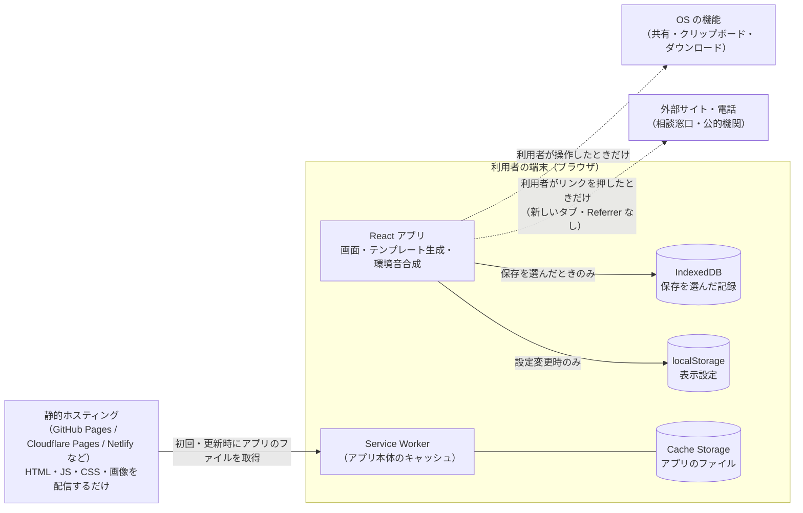
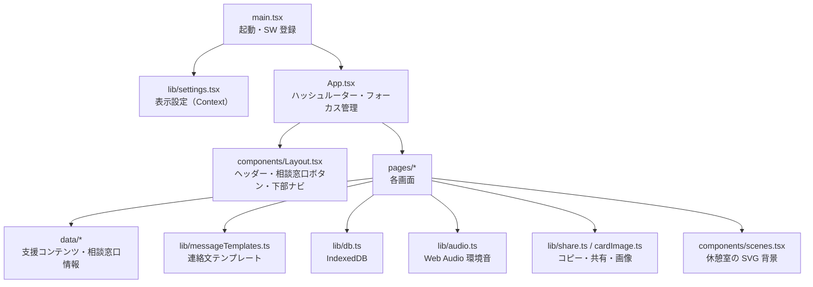

# システム構成図

余白。はサーバー側の処理を持たない **静的な PWA** です。すべての処理は利用者の端末（ブラウザ）の中で完結します。

## 通信について

| 通信 | いつ | 内容 |
| --- | --- | --- |
| ホスティングからの取得 | 初回表示時、更新確認時 | アプリのファイル（HTML / JS / CSS / 画像 / manifest / sw.js）のみ |
| 外部サイト | 利用者がリンクを押したとき | 通常のページ遷移（新しいタブ）。`Referrer-Policy: no-referrer` |
| 電話 | 利用者が番号を押したとき | `tel:` リンクで端末の電話アプリを開く |

- 利用者の入力内容（気持ち・文章・連絡文・カード）を含む通信は **一切ありません**（e2e テストで、アプリの外への通信が 0 件であることを確認）
- アクセス解析・広告・外部フォント・CDN は使っていません
- Service Worker は同一オリジンの GET リクエストだけを扱い、外部サイトへの通信には関与しません

## ソフトウェア構成

| ファイル | 役割 |
| --- | --- |
| `index.html` | エントリ。ビルド時に CSP の `<meta>` を挿入 |
| `public/boot.js` | 描画前にテーマ・文字サイズを反映（画面のちらつき防止）。インラインスクリプトを使わないため外部ファイル |
| `src/sw-template.js` | Service Worker のひな形。ビルド時に `vite.config.ts` のプラグインがファイル一覧を埋め込んで `dist/sw.js` を生成 |
| `public/_headers` | Netlify / Cloudflare Pages 用のセキュリティヘッダー |
| `public/manifest.webmanifest` | PWA の設定（`start_url: ./#/`、`display: standalone`） |

## セキュリティ対策

| 対策 | 内容 |
| --- | --- |
| XSS | React の自動エスケープのみを使い、`dangerouslySetInnerHTML` を使わない。保存データの読み込み時も文字列として表示 |
| CSP | `default-src 'self'; script-src 'self'; style-src 'self'; object-src 'none'; base-uri 'self'; form-action 'none'; frame-src 'none'` など。インラインスクリプトなし（e2e で違反 0 件を確認） |
| クリックジャッキング | `_headers` で `frame-ancestors 'none'` / `X-Frame-Options: DENY`（GitHub Pages では設定不可。docs/deploy.md 参照） |
| 外部リンク | `target="_blank" rel="noopener noreferrer"`、https と `tel:` 以外のリンクは描画しない |
| 権限 | カメラ・マイク・位置情報・通知などを要求しない。`Permissions-Policy` で無効化 |
| 設定値の検証 | localStorage から読む値は許可リストで検証し、想定外の値は初期値に戻す |
| 依存関係 | 実行時の依存は React / ReactDOM のみ |
| 可用性 | オフラインでも動作。保存ができない環境（プライベートブラウズ等）でも、保存以外の機能は使える |
| 完全性 | 更新時は Service Worker のキャッシュをバージョンごとに入れ替え、古いキャッシュは削除 |
| 機密性 | 入力内容は端末外に出ない。保存は同意したときだけ。保存データは暗号化していないことを明示 |
