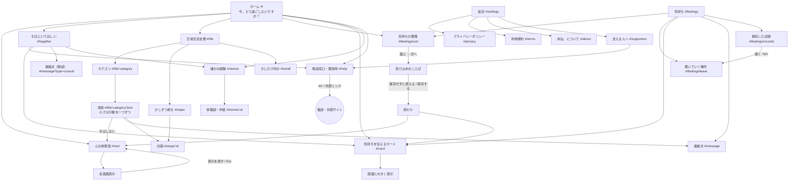

# 画面遷移図

URL はハッシュ形式（例：`https://…/#/life/wake/futon`）です。
**ヘッダーの「相談窓口」（`#/help`）と下部ナビゲーションは、休憩室の全画面表示中を除くすべての画面に表示** されます（全画面表示中も「相談窓口」ボタンは表示）。

## 下部ナビゲーションと現在地

| ナビ | 現在地として扱う画面 |
| --- | --- |
| ホーム | `#/` |
| 休憩 | `#/rest` |
| 生活支援 | `#/life/*`, `#/steps/*`, `#/small` |
| 気持ち | `#/feelings/*`, `#/card`, `#/message` |
| 設定 | `#/settings`, `#/privacy`, `#/terms`, `#/about` |

## 表示モード別のホーム

| 最小 | 標準 | 全機能 |
| --- | --- | --- |
| 静かに過ごしたい | 8つすべて | 8つすべて |
| 誰かにそばにいてほしい | ＋ 伝えるカード / 相談窓口・緊急時 | ＋ 伝えるカード / 相談窓口・緊急時 |
| 日常生活がつらい | | ＋ ほかの機能（連絡文・置いていく・生活に戻る・記録・支える人・設定） |
| 気持ちをうまく伝えられない | | |
| 相談先を探したい | | |

## 存在しない URL

`#/does-not-exist` などは「ページが見つかりませんでした」を表示し、ホームと相談窓口へのボタンを出します。
