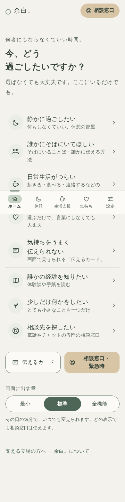
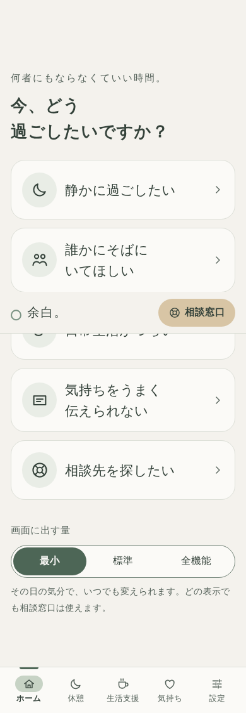
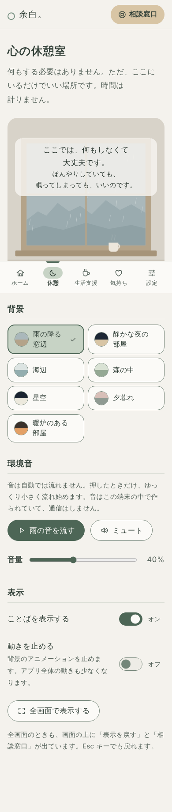
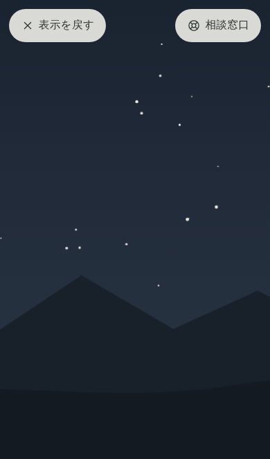
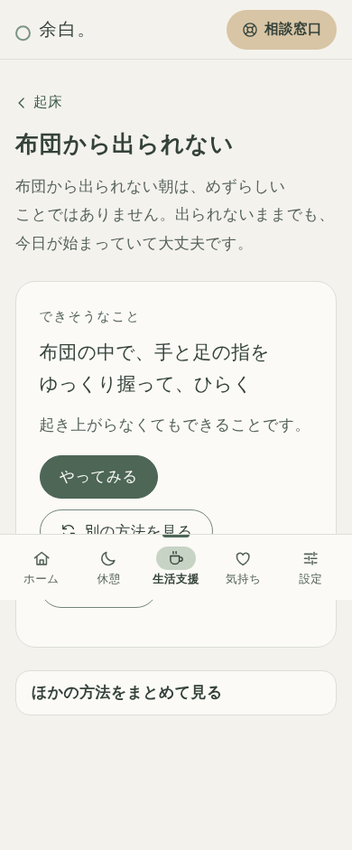
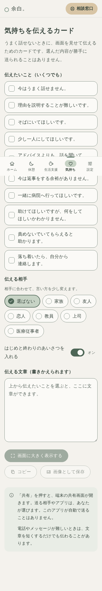
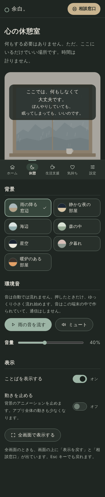
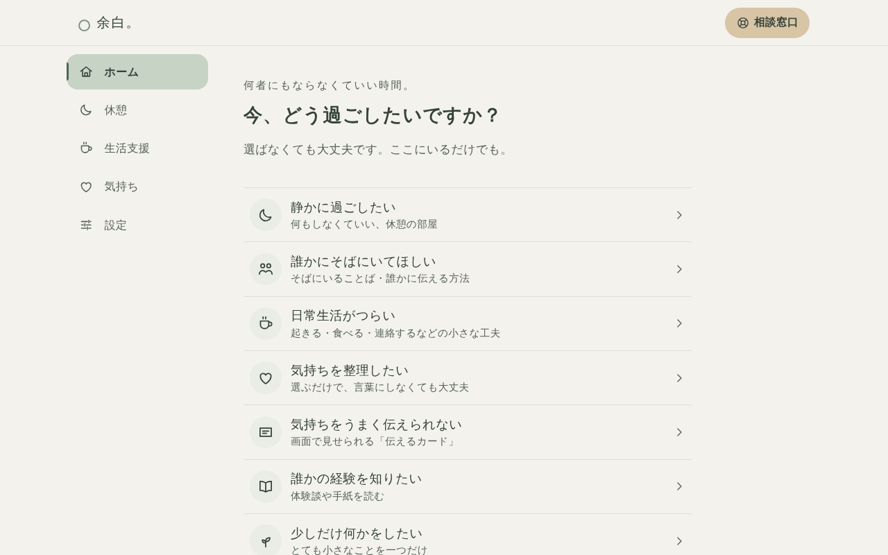

# テスト結果

実施日：2026年11月25日
実施環境：Linux（クラウド開発環境）、Node.js 22.23.5、Chromium（Playwright 1.63.0、ヘッドレス）

## まとめ

| 種類 | 結果 |
| --- | --- |
| 型チェック（TypeScript） | ✅ エラー 0 |
| 本番ビルド（Vite） | ✅ 成功（JS 390KB / gzip 118KB、CSS 34KB / gzip 7KB） |
| 単体テスト（Vitest） | ✅ **85 / 85** 成功 |
| ブラウザでの自動テスト（Playwright + axe-core） | ✅ **213 / 213** 成功 |
| 外部リンクの確認 | ✅ 12 件到達を確認 / ⚠️ 3 件は転送先まで未確認（下表） |

再現方法：`npm test` → `npm run build` → `npm run e2e`（結果は `test-results/e2e-results.json`）

## 指示書「23. 動作確認」の項目

| 確認項目 | 結果 | 確認方法 |
| --- | --- | --- |
| すべてのボタンが正常に動作する | ✅ 主要な操作はすべて自動テストで確認 | e2e「操作」24 項目。各画面の主要ボタン（表示モード、再生・停止・ミュート・音量、背景、全画面、別の方法・今はしない、保存・書き出し・削除、カード表示・コピー・画像保存、連絡文の各選択、できた・飛ばす・やり直し、設定・全削除）を操作 |
| 画面遷移に不具合がない | ✅ | 全 27 画面（存在しない URL を含む）を表示、ホームの 8 選択肢と下部ナビの遷移、見出しへのフォーカス移動を確認 |
| スマートフォンで横スクロールが発生しない | ✅ | 390px（iPhone 13 相当）・320px・320px＋特大文字・820px・1024px・1280px の 6 幅 × 全 27 画面で `scrollWidth` を確認 |
| 文字やボタンが重ならない | ✅ | 同じ条件で、表示中の操作部品どうしの重なり・画面からのはみ出しを自動検出（0 件） |
| オフラインでも基本機能を利用できる | ✅ | Service Worker の登録後に通信を遮断して再読み込みし、休憩室・生活支援・カード・連絡文・相談窓口を表示。オフライン表示も確認 |
| データの保存・削除が正常に動作する | ✅ | 保存 → 再読み込み後も残る → 1件削除 → 全削除で IndexedDB と設定が消えること、同じオリジンの別サイトのデータは消えないことを確認。単体テストでも IndexedDB の保存・上書き・完全削除を確認 |
| 個人の入力内容が外部に送信されていない | ✅ | テスト全体を通して、アプリのオリジン以外への通信が **0 件** であることを記録・確認 |
| 相談窓口へのリンクが有効である | ✅ / ⚠️ 一部未確認 | 下表参照 |
| 表示モードを変更しても主要機能へ移動できる | ✅ | 最小・全機能モードで相談窓口の表示、下部ナビ 5 項目の遷移を確認 |
| ビルドエラーが発生しない | ✅ | `npm run build` 成功 |

## アクセシビリティ

- axe-core 4.14.1 による自動検査（WCAG 2.0/2.1/2.2 の A・AA ルール）：全 27 画面 × ライト／ダーク で **違反 0 件**
- 色のコントラスト：`tests/contrast.test.ts` でライト／ダーク各 25 組を検証（文字 4.5:1 以上、操作部品の枠など 3:1 以上）
- キーボード：Tab で最初に「本文へ移動」に到達し、Enter で本文へ移動できることを確認
- 画面遷移時に見出しへフォーカスが移ることを確認

## セキュリティ

- CSP 違反：テスト全体で **0 件**（参考：テストツールが CSP で禁止されたインラインスクリプトを挿入しようとした際、正しく遮断されることも確認）
- JavaScript のエラー：0 件
- 外部リンク：すべて `https://` で `target="_blank" rel="noopener noreferrer"` であることを確認
- 設定値：壊れた値・想定外の値（`<script>` を含む文字列など）が初期値に戻ることを単体テストで確認

## 外部リンクの確認（2026年11月25日、curl で HTTP ステータスを確認）

| URL | 結果 |
| --- | --- |
| https://www.mhlw.go.jp/mamorouyokokoro/ | ✅ 200 |
| https://www.mhlw.go.jp/mamorouyokokoro/soudan/tel/ | ✅ 200 |
| https://www.mhlw.go.jp/mamorouyokokoro/soudan/sns/ | ✅ 200 |
| https://talkme.jp/ | ✅ 200 |
| https://kokoro.mhlw.go.jp/ | ✅ 200 |
| https://www.mhlw.go.jp/stf/…/gatekeeper2.html | ✅ 200 |
| https://www.mhlw.go.jp/stf/…/gatekeeper3.html | ✅ 200 |
| https://childline.or.jp/chat | ✅ 200 |
| https://www.npo-tms.or.jp/public/kokoro_hotchat/ | ✅ 200 |
| https://react.dev/ | ✅ 200 |
| https://www.lsystem.org/inochi-web | ✅ 到達（503。「ご相談受付の一時休止について（11月1日〜）」のお知らせページ。アプリに反映済み） |
| https://docs.github.com/…/what-is-github-pages | ✅ 200 |
| https://line.me/R/ti/p/%40eds9972b ほか LINE 3 件 | ⚠️ LINE の公式アカウントページ（page.line.me）への転送までを確認。転送先の表示は開発環境のネットワーク制限により **未確認** |
| https://yorisoi-chat.jp/ | ⚠️ https://lifelink.or.jp/4400 への転送までを確認。転送先の表示は **未確認** |
| `tel:` リンク（電話番号 13 件） | ⚠️ 番号の形式はテストで確認。実際の発信は **未確認**（実機での確認が必要） |

## 未確認の項目（実施できなかったもの）

| 項目 | 理由 |
| --- | --- |
| iPhone（Safari）・Android（Chrome）の実機での動作 | 開発環境に実機がないため。Chromium のモバイル表示エミュレーションで代替 |
| Safari / Firefox での動作 | 自動テストは Chromium のみ |
| ホーム画面への追加（PWA としてのインストール） | 実機での操作が必要 |
| 環境音の実際の聞こえ方 | ヘッドレス環境では再生処理（開始・停止・ミュート・音量）のエラーがないことのみ確認。音質は未確認 |
| 全画面表示（Fullscreen API）の実機での挙動 | ヘッドレス環境では「画面いっぱい表示」への切り替えまでを確認 |
| OS の共有画面（Web Share API） | ヘッドレス Chromium では共有画面が開けないため未確認（ボタンの表示条件のみ実装） |
| スクリーンリーダー（VoiceOver / TalkBack）での読み上げ | 自動検査（axe-core）のみ。実機での確認が必要 |
| 電話の発信 | 実機での確認が必要 |
| 心理・医療の専門家による内容確認、当事者による操作性の検証 | 公開前に実施が必要（`docs/content-review.md`） |

## スクリーンショット

`docs/screenshots/` に主要画面を保存しています（e2e 実行時に `SCREENSHOTS=1` を付けると `test-results/screenshots/` に全画面分が出力されます）。

| ホーム | 最小表示 | 心の休憩室 | 全画面 |
| --- | --- | --- | --- |
|  |  |  |  |

| 生活支援 | 伝えるカード | ダークテーマ | パソコン |
| --- | --- | --- | --- |
|  |  |  |  |

※ 全体のスクリーンショットでは、画面下に固定されたナビゲーションが途中に写り込みます（撮影方法による見え方で、実際の画面では画面下に固定されています）。
